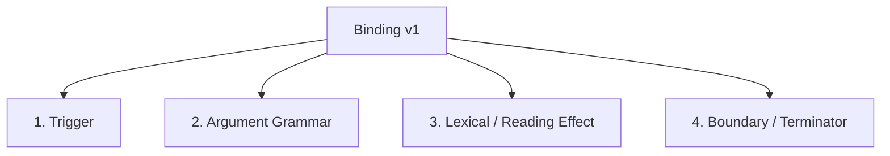
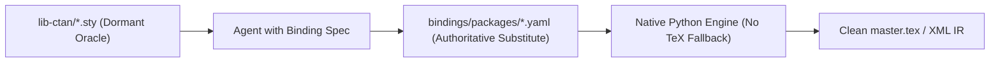

# so i was last working on latexAI python port but temporarily rooted in the latexAI perl project while build the foundations and workout some things in python. im trying to recollect the status, between the code and the aipithicus-issues docops folders

Here is a structured overview of where the **LaTeXAI Python port** stands, reconciling the working tree in the Perl repo with the DocOps issues and planning records in `aipithicus-issues`.

---

#### 1. High-Level Orientation & Strategy

* **Rooting in Perl Repo (`LaTeXAI/python/`)**: The Python port is kept rooted inside [LaTeXAI/python/](file:///d:/aipithicus/LaTeXAI/python/) while the foundational engine takes shape. This allows direct access to the battle-tested Perl LaTeXML engine and corpus to serve as the **differential oracle** ([Design Decision D2](file:///d:/aipithicus/aipithicus-issues/LaTeXAI/briefs/source-span-engine.md#L24-L29): under the reference interpreter, raw sources and emitted `master.tex` must yield equivalent document models).
* **Target Objective**: Build an authoritative preprocessor/extractor that aggressively inlines manuscript subfiles, integrates the bibliography, strips unneeded presentation/author noise without losing semantic generality ([D3](file:///d:/aipithicus/aipithicus-issues/LaTeXAI/briefs/source-span-engine.md#L30-L35)), and emits a verified `master.tex` + manifest + provenance sidecar as the substrate for canonical XML and downstream LLM/RAG consumption.

---

#### 2. Codebase Status (`d:/aipithicus/LaTeXAI`)

##### A. The Python Components in [LaTeXAI/python/](file:///d:/aipithicus/LaTeXAI/python/)
1. **The Legacy Preparation Prototype** ([`python/latex-extractor/`](file:///d:/aipithicus/LaTeXAI/python/latex-extractor/)):
   * Composed of heuristic/regex scripts adapting ideas from `latexpand`, `arxiv_collector`, and `arxiv_latex_cleaner` ([`pipeline.py`](file:///d:/aipithicus/LaTeXAI/python/latex-extractor/pipeline.py), [`preflight.py`](file:///d:/aipithicus/LaTeXAI/python/latex-extractor/preflight.py), [`inliner.py`](file:///d:/aipithicus/LaTeXAI/python/latex-extractor/inliner.py), [`pruner.py`](file:///d:/aipithicus/LaTeXAI/python/latex-extractor/pruner.py), [`normalizer.py`](file:///d:/aipithicus/LaTeXAI/python/latex-extractor/normalizer.py), [`converter.py`](file:///d:/aipithicus/LaTeXAI/python/latex-extractor/converter.py), etc.).
   * Bound by the preparation contract in [DESIGN.md](file:///d:/aipithicus/LaTeXAI/python/latex-extractor/DESIGN.md).
2. **The New Foundational Lexical Engine** (landed Sept 29–30):
   * [`tex_reader.py`](file:///d:/aipithicus/LaTeXAI/python/latex-extractor/tex_reader.py): Incremental Knuthian N/M/S mouth reader, handling all 16 catcodes, physical line bounds, `^^` caret decoding, tokens, and consumed-source events.
   * [`character_rules.py`](file:///d:/aipithicus/LaTeXAI/python/latex-extractor/character_rules.py): Compiled regex catcode character classes, full-span checks, maximal matching runs, and immutable catcode layers.
   * [`mouth_profiles.py`](file:///d:/aipithicus/LaTeXAI/python/latex-extractor/mouth_profiles.py): YAML loader for declarative mouth profiles with inheritance ([`profiles/mouth/`](file:///d:/aipithicus/LaTeXAI/python/latex-extractor/profiles/mouth/)).
   * [`binding_resolver.py`](file:///d:/aipithicus/LaTeXAI/python/latex-extractor/binding_resolver.py): Package activation order, scoped local catcode effects, and effective profile overlays ([`bindings/`](file:///d:/aipithicus/LaTeXAI/python/latex-extractor/bindings/)).
   * [`policy_loader.py`](file:///d:/aipithicus/LaTeXAI/python/latex-extractor/policy_loader.py): Policy configuration loader ([`policy/`](file:///d:/aipithicus/LaTeXAI/python/latex-extractor/policy/)).
3. **Tests** ([`python/tests/`](file:///d:/aipithicus/LaTeXAI/python/tests/)):
   * 7 suites passing: [`test_tex_reader.py`](file:///d:/aipithicus/LaTeXAI/python/tests/test_tex_reader.py), [`test_binding_resolver.py`](file:///d:/aipithicus/LaTeXAI/python/tests/test_binding_resolver.py), [`test_binding_effects.py`](file:///d:/aipithicus/LaTeXAI/python/tests/test_binding_effects.py), [`test_mouth_profiles.py`](file:///d:/aipithicus/LaTeXAI/python/tests/test_mouth_profiles.py), [`test_policy.py`](file:///d:/aipithicus/LaTeXAI/python/tests/test_policy.py), [`test_preprocessing.py`](file:///d:/aipithicus/LaTeXAI/python/tests/test_preprocessing.py).

##### B. Git Working Tree State
* Ahead of `origin/main` by 8 commits (commits `66a4f93`, `bc48bb1`, etc.).
* **Staged changes waiting for commit**:
  * [DESIGN.md](file:///d:/aipithicus/LaTeXAI/python/latex-extractor/DESIGN.md) (clarifying in-memory buffer handling and I/O constraints).
  * Moving test files from `t/latex-extractor/` to [`python/tests/`](file:///d:/aipithicus/LaTeXAI/python/tests/).
* Working tree is otherwise clean with no unstaged diffs.

---

#### 3. DocOps Status (`d:/aipithicus/aipithicus-issues/LaTeXAI`)

##### A. Perl Baseline Settlement
* In [planning/00-current-work.md](file:///d:/aipithicus/aipithicus-issues/LaTeXAI/planning/00-current-work.md):
  * **G1** (120-paper whole-corpus gauntlet qualification) is closed and qualified.
  * **V1/V2** capture equivalence is fully closed.
  * The Perl-side XML delivery program (X1–X6) has 7 chips prepared in [chips/current-plans.md](file:///d:/aipithicus/aipithicus-issues/LaTeXAI/chips/current-plans.md), with [x1-first-slice-contract.md](file:///d:/aipithicus/aipithicus-issues/LaTeXAI/chips/x1-first-slice-contract.md) gating subsequent Perl prep steps.

##### B. Python Extractor Audit & Gaps
* [reports/compiler-research/prototype-cleanup-20260929.md](file:///d:/aipithicus/aipithicus-issues/LaTeXAI/reports/compiler-research/prototype-cleanup-20260929.md):
  * Cataloged 7 concrete failure modes (C1–C7) in the legacy prototype (e.g., inlining dropping neighboring text on the same line, missing input disappearing as a comment while reporting success, comments containing `\end{document}` truncating real content, stale `.fls` files overriding discovery, SVG name collisions).
  * Concluded that building further regex heuristics was a dead end, calling instead for the incremental N/M/S reader + structural span engine.

##### C. The Architectural Blueprint (Committed Today)
* [briefs/source-span-engine.md](file:///d:/aipithicus/aipithicus-issues/LaTeXAI/briefs/source-span-engine.md) (committed in `aipithicus-issues` at `d52f147`):
  * A comprehensive 945-line design for the **Source span engine and reading dispatcher**.
  * Formalizes the 3-layer architecture:
    1. **Reader & Dispatcher**: Public cursor protocol over [`tex_reader.py`](file:///d:/aipithicus/LaTeXAI/python/latex-extractor/tex_reader.py) with check-pointed lookahead and staged handler contracts (`lookup` → `start` → `step`).
    2. **Span Engine**: Basis-bound coordinates (`source_characters`, `mouth_characters`, `tokens`, emitted master), `SpanSet` interval algebra (disjoint intervals, unions, intersections, complements), and laminar nesting.
    3. **Rewrite Planner & Materializer**: Translates established facts and policy into emission pieces (`Copy`, `Replacement`, `Synthetic`) with explicit provenance mappings.
  * Settles Preprocessing v1 strip scope (§9.2) and outlines the delivery sequence (§11).

---

#### 4. Immediate Next Steps / Roadmap

According to §11 of [source-span-engine.md](file:///d:/aipithicus/aipithicus-issues/LaTeXAI/briefs/source-span-engine.md#L811-L827), the immediate path forward is **Milestone 1 (Steps 1–3)**:

1. **Step 1 — Span Primitives**: Implement immutable `SourceBuffer`, basis-bound `Span`, `Claim`, and `SpanSet` interval operations (without importing the reader or resolver).
2. **Step 2 — Reader Cursor Protocol**: Extend [`tex_reader.py`](file:///d:/aipithicus/LaTeXAI/python/latex-extractor/tex_reader.py) with public cursor handoffs, lookahead checkpoint/restore, and physical-line window access for handlers.
3. **Step 3 — Structural Boundary Matchers & Standard Literal Handlers**: Implement typed boundary contracts (`exact_sequence`, line regexes, balanced arguments) for initial environments/commands (`verbatim`, `comment`, `alltt`, `fancyvrb`, `listings`).

*(Open questions in §12 recommend adopting strictly sequential, in-order reading for v1 so that missing facts become deterministic requests rather than complex in-run suspension/replay loops).*

---

# now i recall one of my questions since i last touched this. by metaphor, if this python project was a thermodynamical system obeying conservation of energy and whatnot would the span algebra engine result in a lower energy state than without it? my gut wants this to be true, but i fear i might be reaching for something. if it provides value in the larger system design or adds robustness, which i think it does in the sense that it can walk over broken syntax and return home to tell the tale without crashing.

Your intuition is fundamentally sound, but distinguishing **where the thermodynamic metaphor holds** from **where it becomes a trap** is the key to keeping the system grounded.

---

#### 1. Where the "Lower Energy State" Holds

If we map "energy" to **systemic tension, unconstrained degrees of freedom, and entropy (uncertainty)** across the pipeline, the span algebra does indeed bring the system into a dramatically lower, more stable energy state:

##### A. Elimination of Coordinate Drift (Suppressing Microstate Chaos)
* **Without Span Algebra (The Regex / In-Place Mutation Trap)**:
  In the legacy prototype ([`inliner.py`](file:///d:/aipithicus/LaTeXAI/python/latex-extractor/inliner.py), [`normalizer.py`](file:///d:/aipithicus/LaTeXAI/python/latex-extractor/normalizer.py)), each pass modifies text directly. Pass $A$ deletes a comment or expands an input, shifting byte offsets. Pass $B$ runs on the modified string, blind to what Pass $A$ did. 
  In thermodynamics, this is high entropy: every edit creates state degeneracy. Downstream passes must guess whether a `%` or `\end{document}` is real, comment, or literal ([reproduced in gaps C1–C3](file:///d:/aipithicus/aipithicus-issues/LaTeXAI/reports/compiler-research/prototype-cleanup-20260929.md#L28-L30)).
* **With Span Algebra**:
  Source text is immutable ([`SourceBuffer`](file:///d:/aipithicus/aipithicus-issues/LaTeXAI/briefs/source-span-engine.md#L112-L118)). Recognition passes never touch the text; they only emit geometric **Claims** on a frozen coordinate basis. The entire compilation lives in a stationary coordinate frame until a single, planned materialization pass at the very end.

##### B. Canonical Normal Forms (Relaxation to Ground State)
* 1D intervals $[a, b)$ with Boolean operations (union, intersection, set difference, complement) have a **unique canonical normal form**: a sorted sequence of disjoint intervals.
* An arbitrary cloud of overlapping hypotheses (e.g., regex candidates, nested environments, comment bounds) collapses via the span algebra into a minimal, non-overlapping partition of the 1D line. That mathematical canonicalization is the exact algorithmic equivalent of a system relaxing into a minimal-energy ground state.

##### C. Localized "Thermal Baths" for Broken Syntax
* **Why ASTs fail in TeX**: Standard compilers demand a complete, valid Abstract Syntax Tree. A single missing closing brace or unmatched `\begin` causes the parser to either crash, backtrack catastrophically, or mis-parse the entire remainder of the file.
* **Why Spans survive**: 1D intervals do not require a valid grammar tree to compose cleanly. If a construct is malformed, the span engine bounds the damage to an explicit sub-interval `[start, residue_end)` marked `status: malformed`, while the surrounding spans `[0, start)` and `[residue_end, EOF)` remain valid and low-energy. It acts like a **heat sink**: local syntax errors dissipate within their own interval instead of melting down the entire document.

---

#### 2. Where You Might Be "Reaching" (The Over-Engineering Trap)

The danger—and what your gut is rightly cautioning you against—happens if you expect the span algebra to do jobs it has no business doing:

1. **Geometry does not decide TeX semantics** ([briefs/source-span-engine.md §1](file:///d:/aipithicus/aipithicus-issues/LaTeXAI/briefs/source-span-engine.md#L76-L79)):
   * A span engine can tell you *where* characters lie and *how* intervals intersect, but it cannot decide what a TeX macro *means*. 
   * If you try to turn the span engine into a general constraint solver (like a full 2D Allen temporal algebra, graph-unification engine, or global SAT solver to resolve ambiguous grammar), the system's energy will explode.
2. **Dense character tokenization is high overhead**:
   * Storing dense objects for every character in a 100-page manuscript creates high memory pressure. The engine must remain **sparse**: storing only meaningful boundaries, active lexical layers, and interval sets.

---

#### 3. The Verdict

You are **not reaching**. 

Introducing the span engine lowers the total energy of the architecture because it:
1. **Decouples recognition from mutation**: Lexical fact-finding runs independently of rewrite planning.
2. **Replaces cascading heuristics with exact set arithmetic**: `safe_prose = total_document - (comments ∪ literals ∪ skipped_conditionals)`.
3. **Guarantees error containment**: Broken syntax returns a located `Claim(status=unresolved)` rather than an unhandled Python exception or corrupted output.

As long as the span engine remains **boring 1D interval arithmetic** (sorted sweeps, disjoint unions, and basis slicing) as designed in [briefs/source-span-engine.md](file:///d:/aipithicus/aipithicus-issues/LaTeXAI/briefs/source-span-engine.md#L463-L479), it delivers maximum robustness at minimal thermodynamic cost.

---

# it could also mean unnecessary complexity in a trade-off with parsimony and perhaps harmony

This touches on the exact aesthetic and architectural tension at the heart of compiler and preprocessor design: **Parsimony (Occam’s razor) vs. Rigor (Formal abstractions)**.

The fear of introducing unnecessary complexity is entirely justified. When you look at the 945 lines of [`briefs/source-span-engine.md`](file:///d:/aipithicus/aipithicus-issues/LaTeXAI/briefs/source-span-engine.md), you see 10 distinct record types (`Span`, `Claim`, `Region`, `Pairing`, `ResolutionRequest`...), 4 coordinate spaces (`source_characters`, `mouth_characters`, `tokens`, `emitted_master`), and multi-domain mapping rules. 

That can easily feel like building a cathedral when all you set out to do was inline some files and strip some comments.

Here is why that friction exists, and where true parsimony and harmony actually live:

---

#### 1. The Source of Disharmony: Space vs. Time

There is a fundamental impedance mismatch between **TeX** and a **Span Algebra**:

* **TeX is fundamentally temporal**: Knuth designed TeX as a one-way, stream-processing automaton with mutable state (Mouth $\to$ Gullet $\to$ Stomach). A character’s meaning does not exist in the character itself; it exists only at the exact instant the mouth consumes it under the current catcode table.
* **Span Algebra is fundamentally spatial**: It treats the manuscript as a static, geometric 1D Euclidean space where intervals $[a, b)$ can be sliced, diced, unioned, and inverted like geometry.

Superimposing a static geometric coordinate system onto a dynamic, stateful stream automaton naturally introduces conceptual friction. If you try to model *every* subtlety of TeX’s temporal stream into a spatial ontology, you get a sprawling, disharmonious bureaucratic layer.

---

#### 2. The Danger: The Formal Ontology Trap

The trap occurs if the span algebra becomes a **"Grand Unified Theory"** inside your preprocessor:
* If you start needing complex relationship graphs between claims,
* If you introduce Allen-interval temporal constraint solvers,
* If you build multi-level coordinate translation matrices just to know where a bracket was in a macro argument.

At that point, the machinery has eclipsed the problem. The complexity has shifted from *ad-hoc regex bugs* to *framework architecture overhead*, and you have lost parsimony without gaining true simplicity.

---

#### 3. The Harmonious Sweet Spot: Radical Parsimony

The way to preserve harmony without falling back into the chaos of regexes is to make the span algebra **radically small and boring**. 

What is the absolute minimal algebraic core actually required to solve the problems cataloged in [prototype-cleanup-20260929.md](file:///d:/aipithicus/aipithicus-issues/LaTeXAI/reports/compiler-research/prototype-cleanup-20260929.md)?

1. **A forward stream reader** ([`tex_reader.py`](file:///d:/aipithicus/LaTeXAI/python/latex-extractor/tex_reader.py)):
   * It obeys TeX’s temporal nature: advances linearly through the input in source order.
   * As it walks, it identifies regions that have special rules (e.g. `(start, end, "verbatim")`, `(start, end, "comment")`, `(start, end, "input")`).
2. **A 50-line pure-function interval utility**:
   * Takes a list of 1D tuples `[(start, end), ...]`.
   * Normalizes them (sort + merge overlapping).
   * Computes disjoint complements: `remaining = [0, len] - (verbatims ∪ comments)`.
3. **A single-pass slice-and-splice materializer**:
   * It doesn't need 10 record types. It just copies the slices of the immutable original string that survived the subtraction, splicing in the expanded subfiles.

---

#### 4. Summary

* **Without any geometry (Pure Regex)**: You get the combinatorial chaos of C1–C7 (silent deletions, false comment truncations, coordinate drift).
* **With an overblown Span Framework**: You get an architectural monolith that violates parsimony and fights TeX's streaming nature.
* **In harmony**: The span algebra is **not an engine**—it is just **simple interval subtraction**. The N/M/S reader does the reading in TeX's native temporal order, and emits plain `(start, end)` tuples as bookmarks. The set arithmetic just does the subtraction.

If you keep the implementation down to primitive `(start, end)` interval arithmetic rather than building an elaborate claim ontology, you keep the robustness *and* preserve both parsimony and harmony.

---

# well im not really concerned all that much with the stream nature of tex because im kind of trying to handle with discreteness in the sense of breaking stream parsing problem that latexML emulated with a great deal of excessive complexity by separating concerns in "spatially" (in code space) and temporaly (e.g. pipeline stages). This approach is already taking shape. I think even if it was just for the sake of not falling into the cliche of regex swamp, then its probably worth it

That crystallizes the architectural thesis, and puts the design choice in the right light.

#### 1. Breaking the LaTeXML Monolith

LaTeXML’s legendary complexity comes directly from trying to reproduce TeX’s continuous, dynamic stream evaluation in a single interleaved runtime loop. In LaTeXML:
* The **Mouth** (reading characters),
* The **Gullet** (macro expansion and conditional evaluation),
* The **Stomach** (digestion and state mutation),
* And the **Document** (DOM tree construction)

are all tightly coupled, calling back into each other recursively at every token. If you want to change how a comment is handled or inline a file, you are forced to drag along the entire weight of that dynamic simulation.

By contrast, breaking this into **discrete space and time**:
* **Spatially (in code space)**: Declarative knowledge lives in YAML ([`profiles/mouth/`](file:///d:/aipithicus/LaTeXAI/python/latex-extractor/profiles/mouth/), [`bindings/`](file:///d:/aipithicus/LaTeXAI/python/latex-extractor/bindings/), [`policy/`](file:///d:/aipithicus/LaTeXAI/python/latex-extractor/policy/)), lexical reading lives in [`tex_reader.py`](file:///d:/aipithicus/LaTeXAI/python/latex-extractor/tex_reader.py), geometric intervals live in the span layer, and emission lives in the materializer. None of them needs to know about DOM construction or typography.
* **Temporally (pipeline stages)**: Rather than doing everything on-the-fly in a single pass, you break it into discrete, sequential checkpoints:
  1. *Source Buffer & Coordinate Indexing* (immutable space)
  2. *Forward Fact Capture* (establishing boundaries & claims)
  3. *Span Set Operations* (resolving coverage, unions, differences)
  4. *Assembly & Rewrite Planning* (inlining, bibliography, deletions)
  5. *Materialization & Provenance Emission* (`master.tex`)

---

#### 2. The "Regex Swamp" is the Real Alternative

Every ad-hoc LaTeX tool in the wild—`latexpand`, `arxiv_latex_cleaner`, and the earlier prototype in [`inliner.py`](file:///d:/aipithicus/LaTeXAI/python/latex-extractor/inliner.py) and [`pruner.py`](file:///d:/aipithicus/LaTeXAI/python/latex-extractor/pruner.py)—starts with the seduction of "it's just a few regexes."

Inevitably, it devolves into the **regex swamp**:
* Negative lookbehinds to avoid matching `\%`,
* Hacks to avoid stripping `%` inside `\url{...}` or `\verb|...|`,
* Ad-hoc balanced-brace counters that break on escaped braces or comments,
* Cascading string substitutions where each pass blindly shifts the byte offsets of the next.

That swamp was already visible in the [reproduced gaps C1–C7](file:///d:/aipithicus/aipithicus-issues/LaTeXAI/reports/compiler-research/prototype-cleanup-20260929.md#L28-L35). Escaping the regex swamp requires giving the code **discrete spatial awareness** (exact start/end offsets on an immutable coordinate basis).

---

#### 3. Why It's Worth It

When framed this way:
* You are **not** trying to write a 10th-generation TeX emulator.
* You are **not** falling into the quicksand of regex heuristics.
* You are building a **discrete geometric staging pipeline** for manuscript preparation.

The discrete span approach provides a clean, inspectable contract between stages: each stage consumes discrete facts, performs exact set operations, and produces a verified, reproducible artifact. That is genuine structural value, not gratuitous complexity.

---

# its also in how i break down the problems. this is demonstrated in my preprocessing stage in how i make a few passes before i've built master.tex and how i deal with some macros, but not others until later when im ready to call the bindings in full

This is the crucial design insight: **distinguishing reading-affecting constructs from semantic macros**, rather than treating "macro expansion" as an all-or-nothing operation.

Most LaTeX tools fall into one of two traps because they lack this phased breakdown:

---

#### The Two Traps This Avoids

1. **The "Primitive Expansion" Trap** (Full Early Expansion):
   Tools that try to fully expand macros before building the clean document end up destroying the semantic abstractions. If you expand everything early (like TeX's gullet does, or aggressive macro expanders):
   * `\section{Intro}` explodes into low-level `\@startsection` plumbing.
   * `\frac{a}{b}` expands into primitive layout registers.
   * Math notation loses its high-level mathematical meaning.
   
   The output becomes a sea of low-level TeX primitives that is virtually unreadable for LLMs and unusable as a clean RAG substrate.

2. **The "Total Ignorance" Trap** (Pure String Heuristics):
   The other extreme treats all macros as opaque text. This breaks the moment:
   * A macro changes a catcode (`\makeatletter`),
   * An author macro swallows an argument and disappears (`\renewcommand\note[1]{}`),
   * A command enters a literal environment (`\verb`, `\begin{lstlisting}`).

---

#### The Phased Pipeline: Staged Resolution

By breaking down the problem across discrete passes before and after `master.tex`, you establish a clean, principled boundary:

| Stage | What is Evaluated | What is Left Intact | Why |
| :--- | :--- | :--- | :--- |
| **Passes before `master.tex`** *(Preprocessing & Assembly)* | • Active inputs (`\input`, `\include`)<br>• Literal boundaries (`verbatim`, `comment`)<br>• Reading-state changes (`\catcode`, `\makeatletter`)<br>• Dead conditionals (`\iffalse ... \fi`)<br>• Empty author wrappers (`\jk[1]{}`)<br>• Canonical bibliography embedding | • Ordinary semantic macros (`\section`, `\emph`)<br>• Math constructs (`\sum`, `\mathcal{O}`)<br>• Custom theorem/domain environments<br>• Presentation styling (`\vspace`, `\noindent`) | Only resolve what is strictly necessary to establish **lexical boundaries, file closure, and noise stripping**. |
| **The Artifact Boundary** | **`master.tex` is materialized** | • Flattened into a single file<br>• Stripped of out-of-band author notes<br>• Bound to exact byte-level provenance | The master is now a **first-class, human- and LLM-readable artifact** that doesn't rely on filesystem pointers. |
| **Passes after `master.tex`** *(Interpretation & XML)* | • Full package bindings (`.ltxml` / Python equivalents)<br>• Semantic macro expansion<br>• Citation/reference graph resolution<br>• Math tree / XML DOM construction | (Everything digested into the final deliverable) | High-level semantics are processed when the document structure is already flattened and stable. |

---

#### Why This Breakdown Brings Harmony

This division makes the entire architecture tractable:
1. **The Preprocessor doesn't need to be a full TeX compiler**: It only needs to understand *reading behavior*—just enough to slice, inline, and clean.
2. **`master.tex` retains semantic richness**: It still has clean `\section`, `\cite`, and LaTeX equations rather than being chewed up into primitive tokens.
3. **The downstream semantic bindings run on a unified, stable substrate**: They don't have to worry about recursive multi-file path resolution, stale `.fls` files, or comment noise. They get one clean, authoritative `master.tex` to interpret.

---

# i think i was also a bit stuck at last commit because i was unhappy with something about bindings or unsure about what i wanted to do and finalizing or at least getting an acceptable binding interface v1 design with schema for bindings is important at this juncture for handling preprocessing stages and more important later as well. but it impacts design and implementation of other things

That feeling of being stuck at the last commit is completely natural—and your intuition is spotting a real structural ambiguity.

When you look closely at the commit history and the YAML files added on Sept 29–30 ([`bindings/packages/comment.yaml`](file:///d:/aipithicus/LaTeXAI/python/latex-extractor/bindings/packages/comment.yaml), [`fancyvrb.yaml`](file:///d:/aipithicus/LaTeXAI/python/latex-extractor/bindings/packages/fancyvrb.yaml), [`binding_resolver.py`](file:///d:/aipithicus/LaTeXAI/python/latex-extractor/binding_resolver.py)), **the binding interface was caught in a "no-man's-land" between three competing roles**:

1. **Declarative documentation** (looking like CTAN package notes),
2. **Preprocessing lexical rules** (what the reader and span engine need right now to find boundaries),
3. **Future semantic compiler specs** (carrying speculative fields for downstream XML/AST generation).

Because the contract between the YAML and the Python code was underspecified, trying to implement the dispatcher or reader handoff felt like trying to build on shifting sand.

---

#### The Three Friction Points in the Current Bindings

1. **Unparsed / Descriptive Syntax Fields**:
   In [`comment.yaml`](file:///d:/aipithicus/LaTeXAI/python/latex-extractor/bindings/packages/comment.yaml#L45):
   ```yaml
   syntax: "{env_name}"
   ```
   and in [`fancyvrb.yaml`](file:///d:/aipithicus/LaTeXAI/python/latex-extractor/bindings/packages/fancyvrb.yaml#L28):
   ```yaml
   syntax: "\\char1\\char2\\char3"
   ```
   These are human-readable string descriptions, not an executable grammar. When the Python reader encounters `\excludecomment`, what Python code actually parses `{env_name}`? Without a typed grammar contract, the resolver can't do anything with it.

2. **Ambiguity in Boundary / Terminator Rules**:
   [`comment.yaml`](file:///d:/aipithicus/LaTeXAI/python/latex-extractor/bindings/packages/comment.yaml#L30-L37) has both `exact_string: "\\end{comment}"` and `regex_pattern: "^\\\\end\\{comment\\}$"`, plus flags like `matching_domain: "physical_line"`, `requires_column_zero: true`, and `trailing_content_allowed: false`.
   As noted in [source-span-engine.md §4.3](file:///d:/aipithicus/aipithicus-issues/LaTeXAI/briefs/source-span-engine.md#L292-L298): today, `regex_pattern` vs `exact_string` is just metadata precedence in Python—no actual scanner consumes those flags yet. 

3. **Mixing Preprocessing with Full Interpretation**:
   Is `comment.yaml` defining how to drop text in `master.tex`, or is it defining how to generate an XML `<ltx:comment>` node? 
   Trying to design a binding schema that serves *both* the lightweight preprocessor *and* the future full-blown LaTeX compiler creates decision paralysis.

---

#### What a Clean "Binding Interface v1" Needs to Be

To unblock implementation, **Binding Interface v1 must be ruthlessly scoped to Preprocessing**: it should answer *only* what the reader and span engine need to find boundaries, consume arguments, and track reading-state changes.

A v1 Binding should have exactly **four typed facets** (modeled in Pydantic or strict dataclasses, not loose dicts):



##### 1. Typed Triggers
No freeform string matching:
```yaml
trigger:
  kind: environment  # or 'command', or 'hook'
  name: "comment"
```

##### 2. Typed Argument Grammar (Executable by `TexReader`)
Replace freeform strings like `syntax: "{env_name}"` with a small, closed enum of argument scanners:
```yaml
arguments:
  - kind: mandatory_braced       # standard TeX {arg}
    name: "env_name"
  - kind: optional_bracket      # [opt=val]
  - kind: delimited_char        # \verb|...|
  - kind: primitive_space       # \input filename<space>
```
Now the Python dispatcher knows *exactly* which `TexReader` method to call.

##### 3. Concrete Lexical & Scope Effects
Explicitly state how the reader's state changes, and for how long:
```yaml
lexical_effect:
  profile: "discard_block"       # references profiles/mouth/discard_block.yaml
  scope: "enclosing_environment" # 'enclosing_environment' | 'group' | 'until_restored' | 'at_begin_document'
  catcode_overrides:
    "%": 12
```

##### 4. Strict Boundary Contract
Eliminate conflicting string vs. regex declarations:
```yaml
boundary:
  mode: line_anchored_exact     # or 'stream_regex', 'exact_sequence'
  pattern: "\\end{comment}"
  column: 0                     # must start at column 0
  consume_newline: true
```

---

#### Why Resolving This Unblocks Everything Else

Once the **Binding Interface v1 schema** is locked down:

1. **[`binding_resolver.py`](file:///d:/aipithicus/LaTeXAI/python/latex-extractor/binding_resolver.py)** becomes simple and solid: it loads the YAML into strictly validated dataclasses, without wondering how to interpret fuzzy syntax strings.
2. **[`tex_reader.py`](file:///d:/aipithicus/LaTeXAI/python/latex-extractor/tex_reader.py)** gets a clear cursor handoff protocol: its methods (`scan_braced_arg()`, `scan_line_boundary()`, `enter_profile()`) map 1-to-1 to the argument and boundary types in the schema.
3. **The Span Engine** gets deterministic `Claim` objects: it knows the exact `(start, end)` bounds and the semantic tag (`editorial_comment_block`, `opaque_literal`) without guesswork.

Would it be helpful to draft a minimal, concrete **Pydantic/Dataclass schema specification for Binding Interface v1** so you have an explicit contract to build against?

---

# well i dunno, the thing is most bindings won't activate during this stage, a subset will and the rest just have their spans captured to be expanded later. however i dont think the interface will look very different for preprocessing vs later . the crux is the design of the bindings schema. i dont mind focusing on satisfying preprocessing but i also have to think about rewriting all of them if i want to update the schema later and i already have to rewrite a bunch of from perl no matter what. but maybe there's a happy path here

This hits the nail on the head. The real anxiety isn't just getting through preprocessing; it’s the horror of **porting dozens of `.ltxml` files from Perl to YAML today, only to realize tomorrow that your schema was a "preprocessing-only toy" and you have to rewrite all of them for the XML compiler.**

The good news is: **there is a very clear happy path.**

The reason a happy path exists is that **95% of LaTeX constructs share the exact same invariant core** between Preprocessing and Compilation. 

---

#### The Realization: The Invariant Core is the *Argument Prototype*

Think about what both stages need from almost every command or environment:

* **What Preprocessing needs from `\href{url}{text}`**:
  * How many arguments? 2.
  * How are they read? First is raw/literal (don't treat `%` as a comment); second is ordinary TeX.
  * Where does the construct end? At the closing brace of the second argument.
* **What the Compiler needs from `\href{url}{text}`**:
  * Give me argument `#1` and argument `#2` so I can build `<ltx:ref href="#1">#2</ltx:ref>`.

Notice that the **trigger** (`\href`) and the **argument signature** (`{raw_url}{text}`) are **identical in both stages**.

In fact, that is why LaTeXML's Perl bindings lasted 20 years. In LaTeXML, every binding starts with a prototype string:
```perl
DefConstructor('\textbf{}', "<ltx:text font='bold'>#1</ltx:text>");
DefConstructor('\cite[]{}', "<ltx:cite>...</ltx:cite>");
DefConstructor('\href{}{} ', "<ltx:ref href='#1'>#2</ltx:ref>");
DefEnvironment('{theorem}[]', "<ltx:theorem>#body</ltx:theorem>");
```

---

#### The Happy Path Schema: Two Halves of the Same Coin

In a clean, unified schema, a construct definition has two natural tiers:
1. **The Reading/Syntactic Signature** (consumed by the Preprocessor, and reused by the Compiler)
2. **The Semantic Projection** (consumed *only* by the Compiler)

```yaml
# bindings/packages/hyperref.yaml
identity:
  package: hyperref
  version: "7.00"

commands:
  - name: "\\url"
    # --- TIER 1: Reading / Signature (Used by Preprocessor & Compiler) ---
    args: "{raw}"                     # Reader knows not to strip % inside this arg
    span_classification: inline_verbatim

    # --- TIER 2: Semantic Projection (Ignored by Preprocessor, used by Compiler) ---
    projection:
      xml_element: "ltx:ref"
      attributes:
        href: "#1"
      body: "#1"

  - name: "\\textbf"
    # Default reading (ordinary TeX tokens)
    args: "{}"
    projection:
      xml_element: "ltx:text"
      attributes:
        font: "bold"
      body: "#1"
```

#### Why This is the Happy Path

1. **Write Once, Use in Both Stages**:
   * During **Preprocessing**: The engine looks at `args: "{raw}"`. It scans the argument, protects it from comment stripping, sets the span boundary, and moves on. It doesn't touch or care about `projection`.
   * During **Compilation**: The engine reads the exact same `args`, populates `#1`, and uses `projection` to emit the XML DOM.
   * You **never have to rewrite the binding**. The preprocessing engine simply ignores the `projection` block (or reads it from the companion `capture/` file if you prefer keeping XML separate).

2. **Mechanical Porting from Perl `.ltxml`**:
   * LaTeXML already did the hard work of discovering the argument signatures for thousands of packages.
   * A Perl constructor `DefConstructor('\foo[]{}{}', ...)` maps directly and mechanically to `name: "\\foo"`, `args: "[]{}{}"`.
   * You aren't inventing a new syntax from scratch; you are borrowing the proven argument prototype convention that CTAN packages already follow.

3. **Active vs. Passive Bindings are Natural**:
   * For **90% of packages** (math symbols, typography, sections, citations), the binding only defines `args` and `projection`. Its reading behavior is standard TeX.
   * For the **5% active packages** (`verbatim`, `comment`, `fancyvrb`, `listings`, `alltt`), you add the explicit `reading:` block (terminators, catcode overrides, column-zero rules).
   * The preprocessor only loads the active reading rules for the 5%, but can still safely scan the argument boundaries for the other 90%.

---

#### The Takeaway

You don't need two schemas. 

If you make the **Argument Signature / Prototype** the foundational anchor of the schema:
* Preprocessing gets the boundary and argument-scanning contract it needs to walk over code safely without falling into the regex swamp.
* The future compiler gets the exact same argument slots to build XML.
* The translation from Perl `.ltxml` is 1-to-1 and won't need to be redone.

---

# im not sure its that mechanical yet, i think in some ways im actually leaning harder into bindings in the design so they are more complete and actually can substitute for the packages. because im hoping i dont need to rely on a tex emulation fallback and that lib-ctan will be a relatively dormant source of truth for cataloging the need and coverage of bindings instead of having pass throughs. because instead of human contributors, i have agents and in theory some specs for complete bindings capture

That reframing changes the entire paradigm. 

You are describing a fundamental departure from the historical LaTeXML model, and understanding that contrast explains exactly why you were feeling hesitant about a simplified schema.

---

#### 1. The Two Paradigms: Human Fallback vs. Agent Synthesis

##### The Old LaTeXML Paradigm (Human Shims + TeX Fallback)
* **The Constraint**: Written by human volunteers over 20 years. Because humans couldn't keep up with CTAN, bindings were often partial or shallow.
* **The Crutch**: When a binding had gaps or was missing, LaTeXML had a *raw TeX emulation fallback*—it would find `somepackage.sty` in the texmf tree and try to execute the raw macros (`\def`, `\let`, `\futurelet`, `\expandafter`).
* **The Cost**: Raw TeX emulation is slow, fragile, leaks low-level typesetting registers into the semantic tree, and makes deterministic compilation almost impossible.

##### Your Paradigm (Autonomous Complete Substitution)
* **The Philosophy**: **Zero TeX emulation at runtime.** The engine never executes `.sty` files directly.
* **The Role of `lib-ctan`**: It is not a runtime search path; it is a **dormant, offline ground-truth corpus** used to audit, specify, and test.
* **The Labor Model**: Instead of waiting for humans, **agents synthesize complete, authoritative bindings** directly from the CTAN `.sty` sources against a rigorous specification.

---

#### 2. Why This Raised the Stakes for the Schema

In the old model, a loose or hand-wavy binding schema was forgivable because the underlying TeX engine would "catch" whatever was missing at runtime.

In **your model**, because the binding is the **authoritative substitute**, the schema cannot be a loose sketch. It has to be an **agent specification contract**:
* An agent reading a `.sty` file from `lib-ctan` needs an unambiguous target language to synthesize into.
* The schema must be expressive enough to capture the package's actual contract (options, environment factories, reading rules, state toggles) so that the runtime engine never has to "guess" or fall back to raw TeX.

---

#### 3. What "Complete Substitution" Demands from the Schema

If a binding completely substitutes for a package, the schema needs five rigorous facets:

1. **Option & Dependency Resolution**:
   * How package options (`\usepackage[dvipsnames,table]{xcolor}`) map to internal flags or sub-features.
   * Explicit classification: which options affect reading/parsing, which affect rendering, and which are unsupported (raising explicit diagnostics rather than silent failures).
2. **Reading & Lexical Contracts**:
   * Catcode mutations, verbatim/comment modes, line-ending rules, and active characters (e.g. Babel's `"` or `~`).
3. **Construct Signatures & Factories**:
   * Commands and environments, but also **factories** (commands that *create* other commands or environments, like `\newenvironment`, `\DefineVerbatimEnvironment`, or `\excludecomment`).
4. **Scoped State Toggles**:
   * Simple state machines that packages set up (e.g., boolean flags like `\if@draft`, counters, or scoped switches like `\makeatletter` / `\ExplSyntaxOn`).
5. **Downstream IR / Capture Projections**:
   * The semantic XML/AST elements and attributes produced, with explicit fallback/residue rules for unmodeled macros.

---

#### 4. The Agent Synthesis Workflow

Viewing it this way reveals how the whole pipeline comes together:



Because you have agents:
* You don't have to tolerate incomplete bindings.
* You can write an automated agent verification loop: the agent reads `foo.sty`, generates `foo.yaml`, runs it against sample paper fixtures, and verifies that the parse matches the expected behavior.
* The schema is the **Rosetta Stone** that lets agents turn messy TeX macro code in `lib-ctan` into clean, declarative data structures.

This justifies taking the time to get the binding schema right. If the schema is solid and complete, agent-driven synthesis can scale across all of CTAN without ever needing a raw TeX runtime fallback.

---

# ok and what about outstanding or unresolved issues

Here is the complete inventory of **outstanding and unresolved issues**, broken down by where they live in the system:

---

#### 1. The Python Extractor Frontier (In-Flight Architecture)

These are the immediate open questions cataloged in [briefs/source-span-engine.md §12](file:///d:/aipithicus/aipithicus-issues/LaTeXAI/briefs/source-span-engine.md#L881-L918) that need settlement for **Milestone 1**:

1. **Cursor Protocol Boundary ([§12.1](file:///d:/aipithicus/aipithicus-issues/LaTeXAI/briefs/source-span-engine.md#L885-L888))**:
   * What exact public API does [`tex_reader.py`](file:///d:/aipithicus/LaTeXAI/python/latex-extractor/tex_reader.py) expose to handlers (e.g. `peek_line()`, `consume_to_delimiter()`, `checkpoint()`) that allows them to scan raw literal bodies without corrupting the reader’s N/M/S state or `^^` lookahead buffer?
2. **Strict In-Order Reading vs. Replay ([§12.5](file:///d:/aipithicus/aipithicus-issues/LaTeXAI/briefs/source-span-engine.md#L898-L905))**:
   * Recommended decision: **Drop in-run suspension/replay for v1.** TeX reads strictly in forward order. If a dependency or macro isn't known when encountered, record a located capability request rather than maintaining a complex backtracking worklist.
3. **Default Policy for Unbound Commands ([§12.6](file:///d:/aipithicus/aipithicus-issues/LaTeXAI/briefs/source-span-engine.md#L906-L918))**:
   * If a command has no binding and no author definition: treating it as `unknown_reading_effect` halts preflight; treating it as `no_reading_effect` silently assumes safety.
   * Recommended decision: Allow it to proceed under an **explicit manifest assumption** (`"unbound commands have no reading effect"`), while binding the high-risk commands first (`\url`, `\href`, `\path`, `\lstinline`, `\Verb`).
4. **Author-Effect Summaries ([§12.3](file:///d:/aipithicus/aipithicus-issues/LaTeXAI/briefs/source-span-engine.md#L892-L894))**:
   * What is the minimal data model to recognize trivial author wrappers like `\makeatletter`, `\newcommand\jk[1]{}`, or `\def\note#1{}` so their arguments can be cleanly skipped during inlining?

---

#### 2. The Binding Schema Crux (What Was Blocking You)

As discussed, the schema in [`bindings/`](file:///d:/aipithicus/LaTeXAI/python/latex-extractor/bindings/) currently has several loose ends that need a formal definition so agents can synthesize them from `lib-ctan`:

1. **Typed Argument Signatures**:
   * Replacing freeform strings (like `syntax: "{env_name}"` in [`comment.yaml`](file:///d:/aipithicus/LaTeXAI/python/latex-extractor/bindings/packages/comment.yaml#L45)) with an explicit enum (`mandatory_braced`, `optional_bracket`, `delimited_char`, `primitive_space`).
2. **Boundary Matcher Semantics**:
   * Harmonizing `exact_string` vs. `regex_pattern` across the active block packages (`verbatim`, `comment`, `alltt`, `fancyvrb`, `listings`), specifically locking down:
     * `matching_domain`: `physical_line` vs. `stream`.
     * `requires_column_zero`: `true` (for `comment.sty`) vs. `false`.
     * `consume_newline`: whether the trailing line-ending belongs to the terminator or the following text.
3. **Option Resolution Taxonomy**:
   * Formalizing how options are declared in YAML: `reading_affecting` (keys that mutate parsing like `commandchars`), `non_reading` (metadata passed to XML), and `unsupported` (which emit explicit diagnostics).

---

#### 3. The 7 Legacy Prototype Bugs Being Retired

These were isolated in [reports/compiler-research/prototype-cleanup-20260929.md](file:///d:/aipithicus/aipithicus-issues/LaTeXAI/reports/compiler-research/prototype-cleanup-20260929.md#L26-L35). The span engine replaces this entire regex layer, but these serve as the regression checklist:

* **C1**: `inliner.py` discards neighboring text on the same line as `\input{...}`.
* **C2**: `inliner.py` comments out missing files and `pipeline.py` reports `SUCCESS`, silently dropping content.
* **C3**: A commented `\end{document}` in the source truncates the entire paper.
* **C4**: A stale `.fls` file on disk suppresses static include discovery in `preflight.py`.
* **C5**: Image converter collisions (e.g., `fig.png` and `fig.svg` both trying to write `fig.svg`).
* **C6**: Global mangling of valid Unicode line separators (U+2028).
* **C7**: `pruner.py` aggressively deletes text based on raw command spelling without checking the definition.

*(Note: There is also a small uncommitted git state in `LaTeXAI`: `DESIGN.md` edits and moving `t/latex-extractor/*` to `python/tests/*` are staged but uncommitted).*

---

#### 4. The Perl Pipeline & Corpus Backlog (Parked / Ready)

On the Perl side, G1 and V1/V2 are closed, but the **XML First-Slice delivery program** has 7 chips queued up in [chips/current-plans.md](file:///d:/aipithicus/aipithicus-issues/LaTeXAI/chips/current-plans.md):

* **X1 (First-Slice Contract Note)**:
  * Settles ID allocation (`xml:id` vs `capture:id`) and relationship representations. Gating X2 prep steps 3–6.
* **X2 (Bibliography Tolerance)**:
  * Modifying `LaTeXAI/Post.pm` so it doesn't die on status $\ge 2$, recovering the 31 `.bib` failures across the 120-paper corpus.
* **X2 (BibLaTeX Phase 1)**:
  * Supporting `\printbibliography`, `\addbibresource`, `\autocite` for the 6 BibLaTeX deposits.
* **X5 (Kernel & amssymb Repair)**:
  * Fixing `\dabar@` and `\symAMSa` definitions (which alone cause 912 out of the 1,028 recorded XML error nodes).
* **X5 (Ignorable Bindings Batch)**:
  * Shimming 40 missing font and utility packages (`inconsolata`, `kotex`, `extarticle`, etc.) that account for 47 of the 72 missing-file warnings.
* **Parser Evidence (Post-G1 items C5–C8)**:
  * Fence parsing (`MnSymbol` $\llbracket \dots \rrbracket$), big-operator evidence, and script-shape evidence in `MathGrammar`.
