# Vocabulary round trip, causal records and Merkle comparison

This increment adds opt-in recording to the existing `FormatBuilder` and
`ContentBuilder`, a closed math projection, and a reusable Merkle index over
recorded execution. It qualifies one formula and bounded causal mechanisms.
It does not claim a complete dependency recorder or general package vocabulary.

## One qualified vocabulary round trip

From `python/PyTeXML`, through the repository PowerShell MCP:

```text
python -B -m src.validation.vocab_roundtrip tests/fixtures/engine/vocabulary-roundtrip.json --pdftex <pdftex.exe> --output ../../temp/causal-record/roundtrip
```

The case defines `sq`, `ratio`, and a fraction macro, then executes
`ratio{x}+y_1` through the ordinary engine. Its presentation is projected from
the constructed math nodes to this closed vocabulary: explicit math characters,
atom classes, scripts, fractions and operator limits. Unsupported nodes or atom
attributes stop projection. No author macro survives in canonical output.

The emitted formula is:

```tex
\frac{\mathchar"0178 ^{\mathchar"0032 }}{\mathchar"0032 }\mathchar"202B \mathchar"0179 _{\mathchar"0031 }
```

Both original and canonical formulas run in native INITEX with the same explicit
font/math setup. The original receives the authored preamble; the canonical
receives only the trusted vocabulary definition. Native `showlists` trees match
after removing diagnostic line numbers, preserving node text, branch paths,
atom classes, fraction fields and scripts. The runner requires complete markers,
exact intentional diagnostics and matching ambient font/configuration hashes.
Missing-character or font-substitution warnings produce `native_fallback`, never
an automatic pass. The observation is pre-layout; no rendered-page claim follows.

A negative probe redefines `frac` to addition. Its live meaning guard fails,
and the projection emits addition using explicit math characters. That canonical
formula also matches the native original. Reusing the paper's definition on the
canonical side would have allowed a misleading fraction-labelled result; the
separate trusted environment prevents that route.

Guard receipts compare the encountered fraction definition against a trusted
non-expanding meaning descriptor. They are diagnostic: the engine still executes
every author/redefined macro. This increment does not introduce guarded lifting,
prove transitive meaning dependencies from one hash, or install a general
vocabulary interception layer. Causal relationships retain the macro and
argument history alongside the presentation nodes.

The output contains `canonical.tex`, `content.json`, `execution.json`, both native
probe directories, and `receipt.json`. The explicit native oracle is pdfTeX
3.141592653-2.6-1.40.29, TeX Live 2026, executable SHA-256
`4b582d0be712b74ae5090aba2d7338f185082f6446cbee7b26115e8ab6e21184`.

## Recording and relationship ownership

```text
python -B -m src.engine.content_builder tests/fixtures/engine/content-construction.inventory.json --output ../../temp/causal-record/content.json --record ../../temp/causal-record/execution.json
python -B -m src.engine.format_builder <inventory.json> --output <format.json> --record <execution.json>
```

The Python API uses `ContentBuilder(..., record=True)` or
`FormatBuilder(..., record=True)`; `FormatBuild.record` holds the result.
Recording is disabled by default. The existing general event logger remains a
logging facility; `engine.causal` owns execution relationships.

Each record has a run UUID and distinct run-local event/version identities.
Repeated identical macro calls retain different occurrence IDs. Hashes never
replace those identities. Content JSON names the record in `causal_record`, and
each constructed node carries `origin_event`. Typed source locations retain the
source occurrence and decoded-codepoint range; they are not byte offsets.

| Relationship | Meaning |
| --- | --- |
| `contains` | Execution/observation scope owns another event |
| `consumes_token`, `returns_token` | Dispatch/expansion consumes or passes through the actual token occurrence |
| `derived_from_token`, `produced_by` | Inserted token derives from an earlier token and an expansion occurrence |
| `argument_of`, `captures_token` | Captured argument belongs to a macro invocation and retains its input tokens |
| `reads_version` | A distinct state-read event observes a specific version |
| `writes_version`, `written_by`, `supersedes` | An operation creates a version that replaces a preceding version |
| `restores_from`, `restores_after` | Group exit restores an established outer version after an inner version |
| `constructed_by`, `node_contains` | Content construction belongs to an operation and retains child structure |
| `appends` | An append occurrence references a constructed node; repeated copies remain separate appends |
| `constructed_from` | A retained output-node occurrence refers back to its construction origin |
| `rolls_back` | A rollback event identifies discarded execution attempts |

For an ordinary author macro, one available dependency path is:

```mermaid
flowchart LR
  O[Output node] -->|constructed_from| N[Constructed node]
  N -->|constructed_by| D[Dispatch]
  D -->|consumes_token| T[Inserted token]
  T -->|produced_by| M[Macro expansion]
  M -->|contains| R[State read]
  R -->|reads_version| V[Definition version]
  V -->|written_by| W[Definition operation]
```



The record is a typed relationship graph, including inverse ownership links;
it is not forced into a one-call/one-node tree. Macro replacement execution can
continue through flattened frozen frames. Explicit token derivation connects
those frames without pretending that all downstream work is lexically nested.
Construction, appending, storage/discard, and retained output membership remain
separate. Final output traversal records each occurrence, including copied nodes
and nodes extended with scripts after initial construction.

The current read seams cover resolved meanings and integer/token/state-cell
queries. Writes cover those state families, direct catcode assignments and group
restoration. Versions distinguish global/local writes; global assignment cancels
old restoration entries. Box dimension changes and register consumption have an
`update` scope: they replace the current value without creating or cancelling
group save entries. Argument capture precedes replacement insertion.
`noexpand` retains the cursor's raw-token identity so recording cannot break
put-back behavior.

Rollback preserves attempted events/versions with `rolled_back` status and
restores the live version frontier and token bindings. Failed work is not silently
deleted and cannot become committed evidence. Completed records detach from the
mutable context, so later inspection or assignments cannot mutate the receipt.

Coverage is explicit and partial. Mouth catcode reads, font-metric internals,
hook/configuration internals and external I/O do not yet have complete dependency
edges. Unobserved writes encountered by a tracked read and missing semantic
codecs add `gaps`; those records cannot qualify as matched. This records observed
relationships, not a proof that no untracked dependency exists.

## Merkle comparison

```text
python -B -m src.validation.record_diff <left-execution.json> <right-execution.json> --output <difference.json>
```

`Index.build(record)` verifies identities, relationship targets and version
hashes, then builds an immutable balanced Merkle index over ordered normalized
events, versions and final observables. Relationships retain endpoint occurrence
positions and referenced state-value hashes. Typed source coordinates, run UUIDs
and incidental event-ID spelling are excluded; semantic filenames such as
`jobname` remain values. Rewiring a relationship changes the indexed record.

The index is a separate acceleration structure over the relationship graph.
It is not an execution call tree and does not hash cycles recursively. Reuse
`Index` objects for repeated comparisons. Building/validating the index scans
the input; equal blocks can then be pruned. Aligned changes descend through the
balanced tree. Different record lengths use a declared linear fallback. Inserted
events can shift relationship positions and invalidate later hashes: no universal
O(depth) regression-localization claim is made.

The result reports record equality, selected final-state equality, output
equality, the first differing indexed record, and visited/pruned counters.
Selected final state includes meaning, integer, token and state cells, lexical
tables and scope depth. Diagnostic message accumulation belongs to output, not
the final-state comparison. Input/configuration manifests remain attached as
provenance. This supports a witnessed equal-final-state/different-output case.
Execution-history equality and selected observable equality remain different
claims; neither establishes full TeX equivalence or snapshot purity.

## Qualification evidence

`tests/test_causal_record.py` checks non-perturbing recording, distinct repeated
calls, actual output-to-macro dependency paths, read versions, alias behavior,
local/global restoration, retained rollback, noexpand put-back identity,
relocation metadata, changed relationships, separate state/output results,
immutable cached indexes, box updates and consumption, unattributed write gaps,
and projection refusal boundaries.

The primary native round trip matches, and the redefined-fraction probe also
matches with a failed vocabulary guard. The existing content-construction
inventory completes through the `--record` CLI. Merkle qualification uses 2,048
synthetic operation records plus final observables: the changed record at index
1,700 is found in **18 node visits**, with five equal blocks pruned. Equal indexed
records take one visit. Index construction took about 0.14 seconds per side in
that run and is reported separately. This is a bounded qualification, not a
corpus-scale performance estimate.

The content inventory records 902 events, 203 versions and 1,831 relationships
with no observed gaps. A real changed-register example reports equal selected
final state and different output, locating the first difference at the register
assignment (`e15`); both the differing and equal-record CLI paths were checked.

Receipts and complete test output are under `temp/causal-record/`:

- `roundtrip-qualified/receipt.json` and `redefined-qualified/receipt.json`:
  native comparisons and vocabulary guard observations.
- `content-qualified-record.json`: the recorded content inventory.
- `merkle-qualified/`: real execution differences, CLI results and the synthetic
  benchmark with separate index-construction costs.
- `focused-box-updates/result.json`: 15 focused tests passed.
- `typecheck-qualified/result.json`: registry type check passed for 26 files.
- `suite-qualified/result.json`: 1,350 tests run, 1,347 passed and three skipped
  in 341.837 seconds.

Selective replay, whole-engine dependency closure, guarded lifting and
snapshot-layer purity remain future qualification work.
